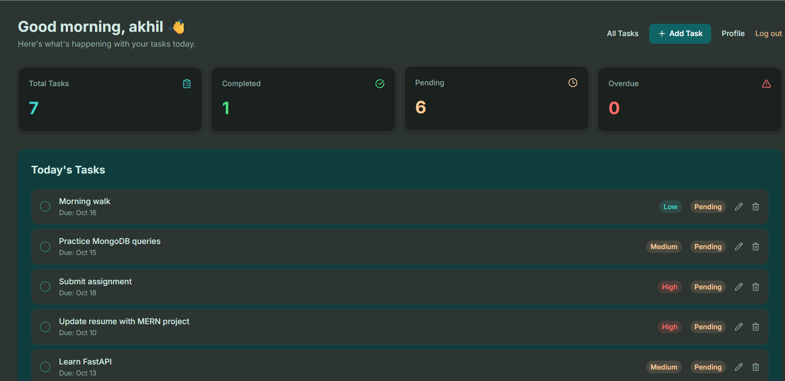
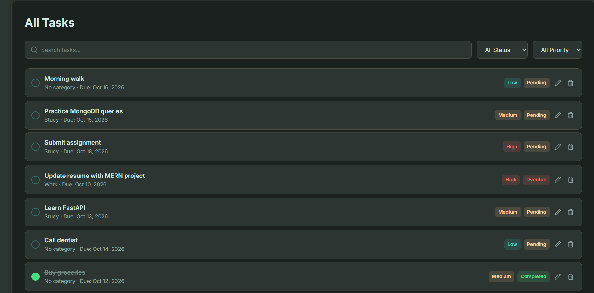
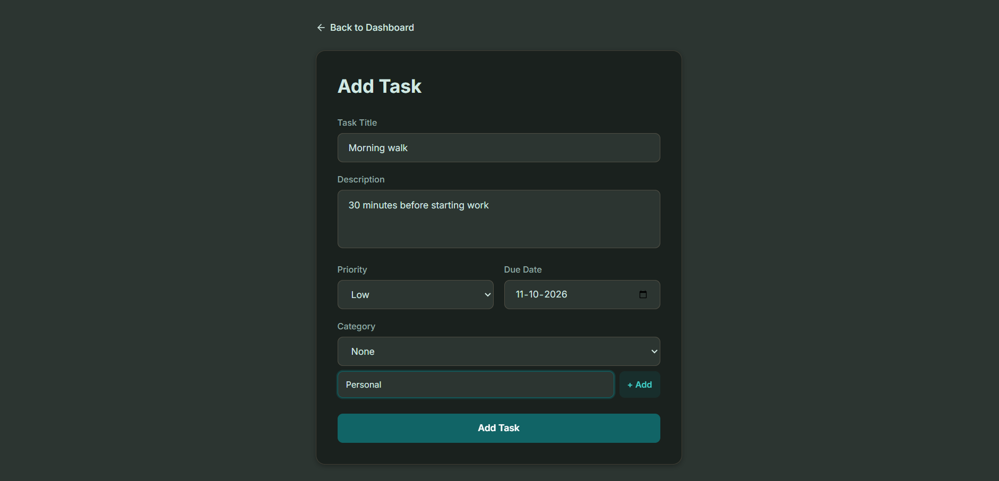
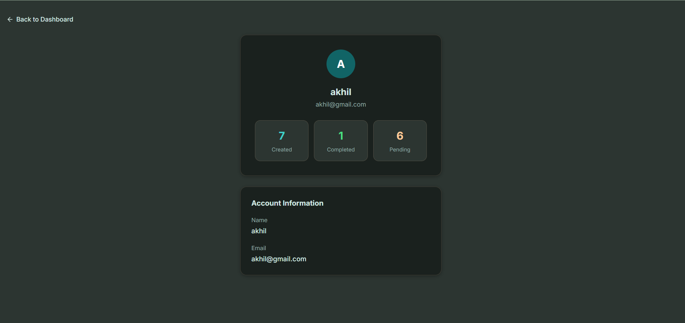

# MERN Task Manager

A full-stack task management app with user authentication, a stats dashboard, and full CRUD for tasks.

**Live demo:** https://mern-todo-app-akhil-d638.vercel.app
**Backend API:** https://mern-todo-backend-gdfu.onrender.com

> The backend is on Render's free tier, so the first request after a quiet period can take 30-60 seconds to wake up.

## Features

- Sign up and log in with JWT authentication and bcrypt-hashed passwords
- Dashboard with Total, Completed, Pending and Overdue stats
- Add, edit, delete and complete tasks
- Task fields: title, description, priority, category, due date, status
- Search and filter by status and priority
- Each user sees only their own tasks
- Profile page with personal task stats
- Responsive dark-teal UI

## Tech Stack

| Layer | Technology |
|---|---|
| Frontend | React, React Router, Tailwind CSS, Lucide icons |
| Backend | Node.js, Express |
| Database | MongoDB Atlas, Mongoose |
| Auth | JSON Web Tokens, bcryptjs |
| Hosting | Vercel (frontend), Render (backend) |

## Screenshots

### Dashboard


### All Tasks


### Add Task


### Profile


## Run Locally

1. Clone the repo:
```
   git clone https://github.com/Akhil-yenimireddy/mern-todo-app.git
   cd mern-todo-app
```
2. Backend:
```
   cd backend
   npm install
```
   Create a `.env` file with:
```
   MONGO_URI=your_mongodb_connection_string
   PORT=5000
   JWT_SECRET=your_secret_key
```
   Then run `node server.js`.
3. Frontend (in a second terminal):
```
   cd frontend
   npm install
   npm start
```
   The frontend points to the live backend by default. To use your local one, replace the Render URL in `frontend/src/pages` with `http://localhost:5000`.

## Author

Akhileswar Reddy Yenimireddy